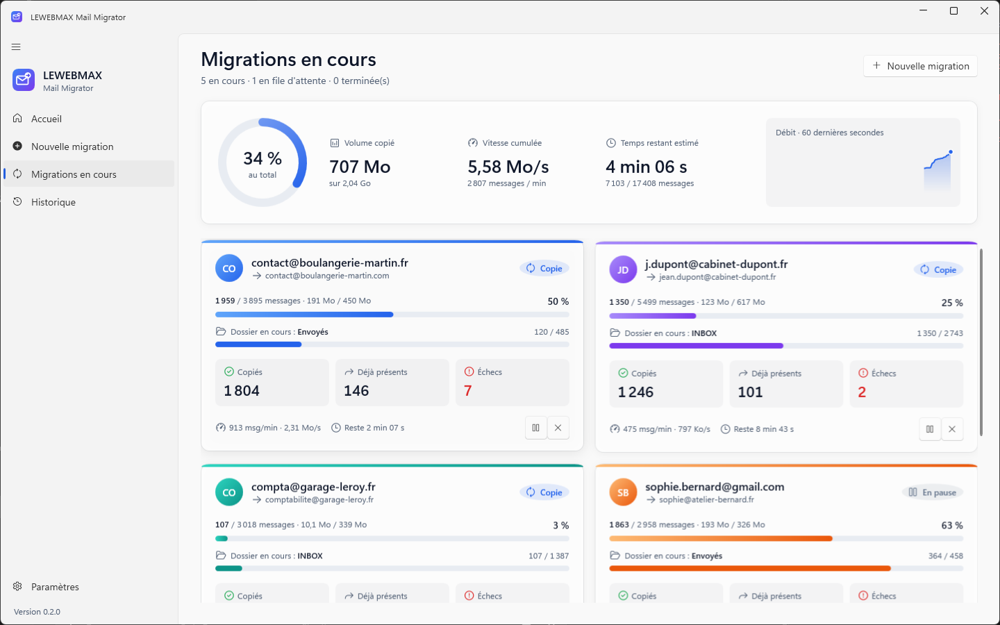

# LEWEBMAX Mail Migrator

Application Windows de migration d'emails IMAP pour les hébergements LEWEBMAX : jusqu'à
5 boîtes en parallèle, détection automatique des serveurs, progression détaillée en direct,
rapport final exportable, et sauvegarde sur le PC pour les changements de serveur.



## Fonctionnalités

**Migration directe boîte → boîte**
- Saisie de 1 à 5 paires source → destination (ou import CSV : `source;mdp source;destination;mdp destination`).
- Détection IMAP automatique : autoconfig du domaine → base ISPDB Thunderbird → autodiscover → enregistrements MX et préfixes `imap.` / `mail.` ; réglages modifiables à la main.
- Test de connexion avec messages d'erreur en français (mot de passe refusé, mot de passe d'application requis, serveur injoignable, certificat, IMAP désactivé…).
- Aperçu réel de la correspondance des dossiers (SPECIAL-USE, noms Sent / Envoyés / Sent Items…, séparateurs `.` et `/`), modifiable.
- Options : corbeille, spams, plage de dates, dossiers exclus, vérification finale, effacement des mots de passe à la fin.

**Moteur**
- Dossiers, drapeaux (lu, important, répondu, brouillon) et date de réception conservés.
- Aucun doublon : Message-ID, sinon empreinte date + expéditeur + sujet + taille ; relancer une migration ne copie que les nouveaux messages.
- Reprise après fermeture ou plantage : l'état de chaque message est enregistré dans SQLite.
- Copie par lots (un FETCH et un MULTIAPPEND pour 50 messages) avec téléchargement du lot suivant pendant l'envoi.
- Reconnexion automatique (backoff exponentiel) ; ralentissement automatique quand le serveur limite le débit.
- Messages volumineux téléchargés par morceaux vers un fichier temporaire.
- Pause, reprise, annulation par tâche ; 1 à 5 tâches simultanées, les suivantes en file d'attente.

**Sauvegarde sur ce PC** (en complément de la migration directe)
- Boîte → PC : sauvegarde chiffrée (AES-256 + HMAC, clé protégée par votre session Windows) ou fichiers `.eml` lisibles.
- Mise à jour : récupère les emails arrivés pendant la propagation DNS.
- PC → boîte : restauration vers le nouveau serveur, sans doublon, dossiers et rôles conservés.
- Écran « Sauvegardes locales » : mettre à jour, restaurer, ouvrir, supprimer, ajouter une sauvegarde existante.

**Suivi et rapports**
- Tableau de bord : anneau de progression global, volume, vitesse, temps restant, courbe du débit ; une carte par tâche avec sa couleur ; panneau de détail avec dossiers et flux d'activité en direct.
- Rapport : chiffres clés, bilan par dossier, recomptage source / destination avec écarts, liste des messages filtrable, « Réessayer les échecs ».
- Exports **HTML** (au design de l'application, imprimable, lisible sur mobile) et **CSV** (Excel).
- Historique de toutes les migrations ; notifications Windows en fin de migration.

**Sécurité**
- Mots de passe chiffrés avec DPAPI, jamais écrits dans les journaux ; effacés à la fin par défaut.
- TLS par défaut ; connexion non chiffrée seulement si elle est choisie explicitement, avec avertissement.
- Une seule instance de l'application à la fois (pas de migration reprise en double).

## Version Android

Application Android (`src/MailMigrator.Mobile`, .NET MAUI) qui réutilise le même cœur
(`MailMigrator.Core`) : détection des serveurs, test de connexion, moteur rapide par lots,
reprise, déduplication, ralentissement automatique, rapports.

- **Migrations** : migrations en cours (progression, copiés / déjà présents / échecs, vitesse,
  temps restant, pause / reprise / annulation) et historique ; un appui ouvre le rapport.
- **Nouvelle** : source et destination, serveur détecté automatiquement, test de connexion,
  options (corbeille, spams, vérification, effacement des mots de passe).
- **Rapport** : chiffres clés, bilan par dossier avec écarts, échecs, **partage HTML / CSV**
  (e-mail, WhatsApp, Drive…), « Réessayer les échecs ».
- La migration tourne dans un **service au premier plan** avec une notification de progression :
  elle continue écran éteint ; notification à la fin. Reprise automatique au redémarrage de l'app.
- Mots de passe chiffrés par le **Keystore Android** (AES-256-GCM, clé non exportable).
- Android 8.0 (API 26) ou plus récent.

Installation : téléchargez `LEWEBMAX-MailMigrator-<version>.apk` depuis la page **Releases**,
ouvrez-le sur le téléphone et autorisez l'installation depuis cette source.

Compilation (nécessite `dotnet workload install maui-android`) :

```bash
dotnet publish src/MailMigrator.Mobile/MailMigrator.Mobile.csproj -c Release -f net10.0-android -o publish/android
```

Signature : la version Release est signée si les variables `ANDROID_KEYSTORE` (chemin du fichier
`.keystore`, alias `lewebmax`) et `ANDROID_KEYSTORE_PASSWORD` sont définies. Sur GitHub, les secrets
`ANDROID_KEYSTORE_BASE64` et `ANDROID_KEYSTORE_PASSWORD` remplissent ce rôle ; sans eux, l'APK de
la CI est signé avec une clé de débogage (installable, mais incompatible avec les mises à jour signées).
**Conservez précieusement la clé** : sans elle, impossible de publier une mise à jour de l'application.

## Installer l'application

Lancez `LEWEBMAX-MailMigrator-Setup-<version>.exe` (voir « Créer l'installeur »).
- Installation par utilisateur, **sans droits administrateur**, dans `%LOCALAPPDATA%\Programs\LEWEBMAX\Mail Migrator`.
- **.NET n'a pas besoin d'être installé** : l'application est autonome.
- Raccourci dans le menu Démarrer, icône de bureau en option.
- La désinstallation conserve les données : `%LOCALAPPDATA%\LEWEBMAX\MailMigrator` (historique, journaux) et `Documents\LEWEBMAX` (sauvegardes, rapports).

Configuration minimale : Windows 10 version 1809 (64 bits) ou plus récent ; Windows 11 recommandé (effet Mica).

## Compilation automatique (GitHub Actions)

À chaque push sur `main`, GitHub compile la solution, lance les tests unitaires et d'intégration
(GreenMail) puis construit l'installeur, téléchargeable dans l'onglet **Actions** (artefact « installeur »).
Pour publier une version : `git tag v0.9.0 && git push origin v0.9.0` — une **Release** est créée
avec l'installeur en pièce jointe. Workflow : `.github/workflows/build.yml`.

## Développement

### Prérequis
- [SDK .NET 8](https://dotnet.microsoft.com/download/dotnet/8.0) : `winget install Microsoft.DotNet.SDK.8`
- Pour les tests d'intégration : Java (`winget install EclipseAdoptium.Temurin.21.JRE`) — ou Docker
- Pour l'installeur : Inno Setup 6 (`winget install JRSoftware.InnoSetup`)

### Compiler et lancer

```bash
dotnet build MailMigrator.sln
dotnet run --project src/MailMigrator.App
```

Mode démonstration (5 migrations simulées, aucune boîte touchée) :

```bash
dotnet run --project src/MailMigrator.App -- --demo
```

### Tests

```bash
dotnet test
```

Les tests qui touchent de vrais serveurs sont inactifs par défaut (ils passent sans rien faire) :

| Catégorie | Ce qui est testé | Lancement |
|---|---|---|
| `Integration` | Adaptateur MailKit, moteur complet, sauvegarde/restauration contre un vrai serveur IMAP (GreenMail) | `scripts\test-integration.ps1` (Java, sans Docker) ou `docker compose -f docker/docker-compose.yml up -d` puis `MAILMIGRATOR_GREENMAIL=127.0.0.1:3143 dotnet test --filter Category=Integration` |
| `Live` | Détection, connexion et migration sur deux boîtes de test **jetables** | `scripts\test-live.ps1` |
| `Network` | Détection sur de vrais domaines (Gmail, Orange, Free…) | `MAILMIGRATOR_NETWORK_TESTS=1 dotnet test --filter Category=Network` |

Scripts utiles (identifiants demandés à l'exécution, jamais enregistrés) :
- `scripts\seed-test-mailbox.ps1` — remplit une boîte jetable avec du courrier réaliste (dossiers, drapeaux, pièces jointes) ;
- `scripts\compare-dates.ps1` — compare les dates (en-tête et réception IMAP) entre source et destination.

### Créer l'installeur

```bash
powershell -ExecutionPolicy Bypass -File scripts/build-installer.ps1
```

Le script lance les tests, publie l'application autonome (`publish\win-x64`), puis compile
`installer\MailMigrator.iss`. Résultat : `installer\Output\LEWEBMAX-MailMigrator-Setup-<version>.exe`.
La version se règle à un seul endroit : `Directory.Build.props`.

### Captures du design

```bash
dotnet run --project src/MailMigrator.App -- --screenshots docs/captures
```

Parcourt tous les écrans en thème clair puis sombre ; aperçu dans `docs/captures/apercu.html`.

## Structure

| Projet | Rôle |
|---|---|
| `src/MailMigrator.Core` | Logique pure, sans interface : détection, connexion, moteur, sauvegardes locales, SQLite, rapports et exports. Réutilisable dans un service web. |
| `src/MailMigrator.App` | Application WPF (.NET 8, WPF-UI, MVVM CommunityToolkit, Serilog). |
| `tests/MailMigrator.Tests` | Tests xUnit : unitaires, intégration GreenMail, tests réseau et boîtes réelles optionnels. |
| `installer/` | Script Inno Setup. |
| `docker/` | Serveur IMAP de test (GreenMail) pour Docker. |

Personnalisation de la charte : couleur d'accent dans `src/MailMigrator.App/Themes/Accent.xaml`,
logo dans `src/MailMigrator.App/Assets/Logo.xaml`, icône générée par `scripts\make-icon.ps1`.

Données de l'application : `%LOCALAPPDATA%\LEWEBMAX\MailMigrator` (`migrations.db`, `logs\`).

## Hors périmètre de la V1
- Connexion OAuth2 Gmail / Microsoft 365 (l'interface `IAuthProvider` est prête) : utiliser un mot de passe d'application.
- Contacts et calendriers (CardDAV / CalDAV), source POP3.
